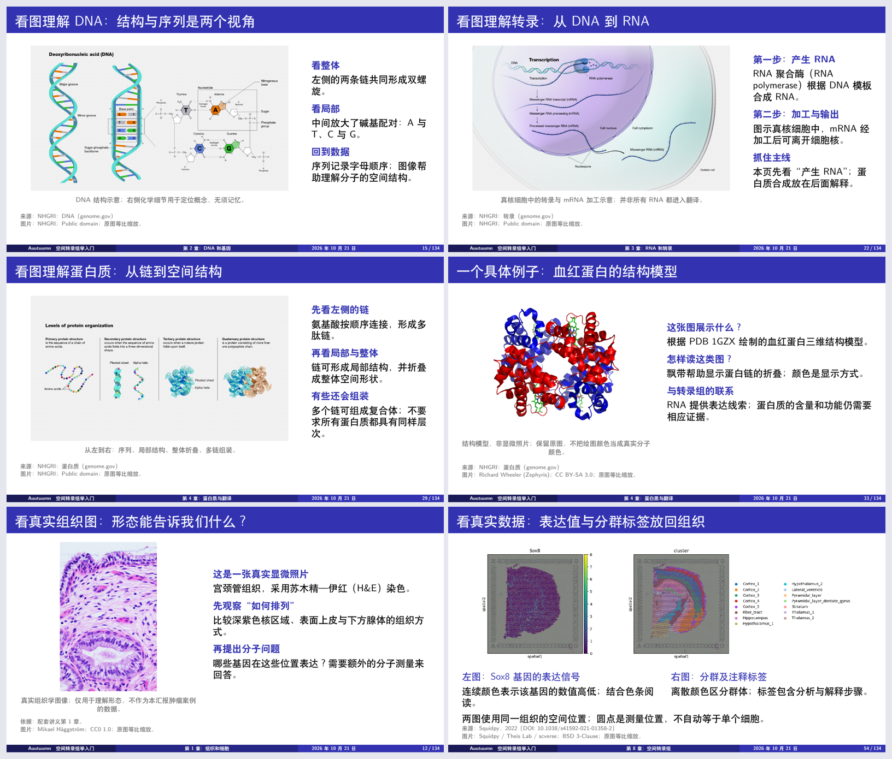

# 空间转录组学入门教程

**从细胞与分子，到表达矩阵、空间信息与科研问题。**

An introductory guide to spatial transcriptomics for students with a CS / AI background.

空间转录组学（Spatial Transcriptomics，ST）连接了生物学实验、组织图像与计算分析。对于有计算机或人工智能背景的初学者，理解数据之前，往往需要先弄清细胞、基因、RNA 和基因表达之间的关系。

这份中文教程从这些基础概念出发，逐步介绍实验读数怎样形成表达矩阵，空间坐标与组织图像怎样对应，以及算法可以研究哪些问题、研究结论又该怎样验证。仓库同时提供**入门讲义、Beamer 汇报、逐页讲述提示和可编辑的 LaTeX 源码**，适合自学、组会分享与入门教学。

## 从这里开始

| 你想做什么 | 推荐入口 |
| --- | --- |
| 系统学习基础知识 | [阅读入门讲义 PDF](讲义与ppt/入门讲义/空间转录组学_CS_AI入门_讲义.pdf) |
| 浏览或放映课程内容 | [打开学术汇报 PDF](讲义与ppt/学术汇报/空间转录组学_CS_AI_学术汇报.pdf) |
| 准备讲解或组会分享 | [逐页讲述提示](讲义与ppt/学术汇报/逐页讲述提示.md) · [章节页码对照](讲义与ppt/学术汇报/章节页码对照.md) |
| 修改内容或排版 | [讲义源码](源码项目/入门讲义/) · [汇报源码](源码项目/学术汇报/) |
| 下载完整项目用于分享或编译 | [LaTeX 项目压缩包](项目压缩包/) |

直接阅读 PDF 无需安装 LaTeX。汇报采用 16:9 Beamer 排版，当前提供 PDF 放映版。

## 适合谁

- 有计算机、人工智能或相关专业背景，刚接触空间转录组学的本科生、研究生。
- 希望先补齐生物学概念，再理解数据结构与分析方法的读者。
- 需要一套中文讲义和汇报材料，用于自学、组会或课程分享的同学。

不要求预先学过分子生物学。进入矩阵与算法部分时，基本的线性代数和机器学习知识会有帮助。

## 能学到什么

教程按 **17 章**展开，建议沿着“研究对象 → 测量方法 → 数据表示 → 分析与验证”的顺序阅读。

| 阶段 | 章节 | 主要内容 |
| --- | --- | --- |
| 认识生物学基础 | 第 1–5 章 | 组织与细胞、DNA 与基因、RNA 与转录、蛋白质与翻译、基因表达 |
| 理解实验在测什么 | 第 6–9 章 | 转录组、混合与单细胞测量、空间信息、位置标签与实验读数 |
| 把实验读数连接到数据 | 第 10–12 章 | 表达矩阵、空间坐标、组织图像、AnnData / H5AD 与常见分析流程 |
| 进入算法与科研问题 | 第 13–15 章 | 空间区域识别、细胞组成、图像与表达、研究设计、评估与结论边界 |
| 回查与继续阅读 | 第 16–17 章 | 核心术语、常见混淆、参考来源与延伸阅读 |

读完后，希望你能够用自己的话回答：

- 空间转录组测量什么，为什么要保留组织中的位置？
- 表达矩阵的一行、一列和一个数分别代表什么？
- 表达相似、空间相邻和组织形态之间有什么联系？
- 聚类、注释、空间分析等步骤分别在解决什么问题？
- 一个模型的结果需要哪些验证，才能支持相应的科学结论？

材料用组织与细胞的配图帮助建立直觉，并通过贯穿章节的组织研究案例、简化计数和矩阵示例连接概念与数据。教学构造的数值和布局在材料中有相应标注。

<details>
<summary>查看汇报页面预览</summary>



</details>

## 仓库结构

```text
st-tutorial/
├── 讲义与ppt/
│   ├── 入门讲义/          # 讲义 PDF 与配图预览
│   └── 学术汇报/          # 汇报 PDF、讲述提示、章节页码与预览
├── 源码项目/
│   ├── 入门讲义/          # 讲义 TeX、配图及来源说明
│   └── 学术汇报/          # 主文件、幻灯片内容、样式及配图
├── Beamer模板/            # 两套可独立使用的中文汇报模板
└── 项目压缩包/            # 已打包的完整 LaTeX 项目
```

## 编辑与编译

需要修改内容时，请保留整个源码项目及其配图目录，使用 **XeLaTeX** 连续编译两次。

在仓库根目录打开终端，编译讲义：

```sh
cd "源码项目/入门讲义"
xelatex "空间转录组学_CS_AI入门_讲义.tex"
xelatex "空间转录组学_CS_AI入门_讲义.tex"
```

编译汇报时，同样从仓库根目录进入对应项目：

```sh
cd "源码项目/学术汇报"
xelatex main.tex
xelatex main.tex
```

汇报项目中，`main.tex` 用于设置标题、作者等信息，`slides.tex` 保存页面内容，`theme.tex` 控制样式。也可以将完整项目压缩包上传到 Overleaf，选择 XeLaTeX 和对应的主文件。

重新编译的 PDF 会生成在源码目录。检查后，再更新到“讲义与ppt”中的对应成品位置。项目压缩包保存的是既有版本；修改源码后，分享最新版时需要重新打包。

## 图片与参考来源

讲义和汇报中保留了图片署名、出处及参考来源，详细清单见：

- [讲义图片来源与许可](源码项目/入门讲义/空间转录组学_CS_AI入门_讲义_图片来源与许可.md)
- [汇报图片来源与许可](源码项目/学术汇报/图片来源与许可.md)

仓库暂未添加统一的开源许可证，第三方图片及素材的许可信息见对应来源说明。

## 交流与反馈

欢迎通过 [Issues](https://github.com/auutuumn222/st-tutorial/issues) 反馈概念解释、文字表述、排版或链接问题。指出对应章节、页码和具体内容，有助于定位与修订。
